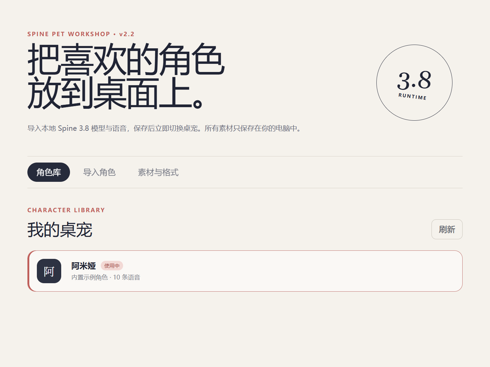
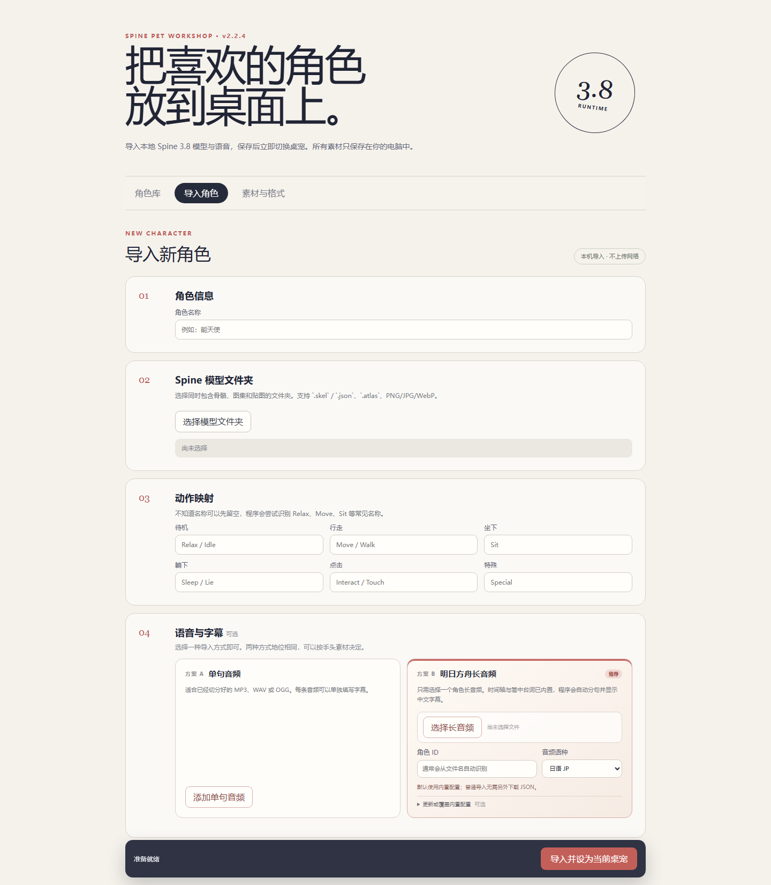

# Spine 桌宠工坊

Windows 桌宠工具，支持 Spine 3.8 动画、语音字幕、拖动、重力、窗口吸附，以及本地角色和语音导入。

当前最新正式版：**v2.2.4**。固定阿米娅版：**v2.1.1**。

## 下载与运行

普通用户直接下载 Windows x64 软件，无需安装 Node.js、pnpm 或 Electron：

- [安装版 v2.2.4](https://github.com/xjunrao-ux/spine-pet-workshop/releases/download/v2.2.4/Spine-Pet-Workshop-Setup-v2.2.4-x64.exe)：双击安装，从桌面快捷方式启动。
- [便携版 v2.2.4](https://github.com/xjunrao-ux/spine-pet-workshop/releases/download/v2.2.4/Spine-Pet-Workshop-Portable-v2.2.4-x64.exe)：双击直接启动。
- [全部正式版本](https://github.com/xjunrao-ux/spine-pet-workshop/releases)：历史版本、更新说明、使用说明和校验文件。

GitHub 自动生成的 `Source code.zip` 是开发源码，不是可运行的安装包。

## 第一次使用

1. 启动程序，首次运行会打开桌宠和角色管理窗口。
2. 可以直接使用默认阿米娅，也可以在“导入角色”中选择自己的 Spine 3.8 模型文件夹。
3. 左键拖动人物，短按互动；右键人物或托盘图标打开设置、角色管理器，或退出程序。

角色模型通常由 `.skel/.json + .atlas + 贴图` 组成。语音支持单句音频配字幕，或长音频配时间轴；导入只在本机进行。

完整步骤和故障排查见 [v2.2 使用说明](docs/versions/v2.2.md)。固定角色版见 [v2.1 使用说明](docs/versions/v2.1.md)。



## 导入角色文件

将小人骨骼文件和角色语音文件导入角色管理窗口。



## 功能

- 透明无边框窗口、托盘和右键菜单。
- 待机、行走、坐下、睡眠、互动及动作混合。
- 拖动、重力、自动行走、边缘转向和窗口吸附。
- 大小调节、语音开关、中文字幕。
- 本地角色库、动作映射、模型与语音导入。
- 小兔子应用图标、Windows x64 安装版和便携版。

## 版本

| 版本 | 状态 | 内容 |
| --- | --- | --- |
| v1 | 本地测试，不公开发布 | 角色和基础动作 |
| v2.1.1 | 正式版 | 包装好的阿米娅桌宠，动作、语音、字幕和置顶修复 |
| v2.2.4 | 最新正式版 | 导入 Spine 角色、自定义语音、长音频分句和角色管理 |
| v3 | 本地开发中 | 音乐控制、通知等扩展；不属于当前发行版 |
| v4 | 规划中 | 评估 AI 对话和行为能力 |

详见 [更新日志](CHANGELOG.md)、[版本前瞻](ROADMAP.md)。

## 开发

技术栈：Electron、TypeScript、Vite、PixiJS、Spine 3.8、PowerShell / Win32。

```powershell
pnpm install --frozen-lockfile
pnpm dev
```

构建与打包：

```powershell
pnpm build
pnpm package:win
```

首次使用 pnpm 时可按 `package.json` 安装 pnpm 11.19.0。构建产物写入 `release/`，不提交到 Git。第三方角色模型和音频不在公共源码中；从源码运行时请准备本地素材，或通过角色管理器导入自己的角色，详见 [素材说明](public/README.md)。

```text
electron/   主进程、系统窗口、IPC 和语音配置解析
src/        动画、交互、字幕及角色管理界面
public/     运行资源和来源说明
assets/     软件图标
docs/       使用、开发与版本发布说明
scripts/    发布工具
.github/    GitHub 构建验证
```

维护者请看 [本地开发与 Git 使用](docs/DEVELOPMENT.md)、[正式发布流程](docs/RELEASING.md)。

## 素材与许可

本项目不是《明日方舟》官方项目。角色、模型、动画、语音、台词和美术内容的权利归各自权利人所有。素材来源保留在对应的 `SOURCE.md` 中，使用和分发素材需遵守其来源条款。

代码目前没有授予开源复用许可，`package.json` 标记为 `UNLICENSED`。Spine Runtime 有独立许可；代码与第三方素材的许可范围应分别处理。
