# Spine 桌宠工坊

把喜欢的角色放到 Windows 桌面上：导入本地 Spine 3.8 模型与语音，让小人走动、坐在窗口边缘、说话，也可以控制音乐、查看通知、记录待办，并按需添加天气预报和 Codex 状态插件。

当前正式版 **v3.2.3 · Windows x64**。新增 GitHub 社区插件目录、开发入口和计数器示例。内置音乐、系统通知和待办；天气与 Codex 通过本地 ZIP 安装。页面用左右箭头翻页，滚轮只滚动当前页。本版不提供 AI 对话。

[社区插件](community/README.md) · [开发插件](docs/PLUGIN_QUICKSTART.md) · [下载与运行](#下载与运行) · [第一次使用](#第一次使用) · [待办事项](#待办事项) · [天气与codex插件](#天气与-codex-插件) · [导入角色](#导入新角色) · [常见问题](#常见问题)

## 下载与运行

普通用户下载 EXE 即可，**不需要安装 Node.js、pnpm 或 Electron**。

- [安装版 v3.2.3](https://github.com/xjunrao-ux/spine-pet-workshop/releases/download/v3.2.3/Spine-Pet-Workshop-Setup-v3.2.3-x64.exe)：双击安装，从桌面快捷方式启动。
- [便携版 v3.2.3](https://github.com/xjunrao-ux/spine-pet-workshop/releases/download/v3.2.3/Spine-Pet-Workshop-Portable-v3.2.3-x64.exe)：放在固定文件夹内，双击直接启动。
- [计数器示例 v1.0.0](https://github.com/xjunrao-ux/spine-pet-workshop/releases/download/v3.2.3/Hello-Counter-v1.0.0.zip)：零权限入门插件，点击加一、清零，重启归零；附[开发教程](docs/PLUGIN_QUICKSTART.md)。
- [天气插件 v1.1.0](https://github.com/xjunrao-ux/spine-pet-workshop/releases/download/v3.2.3/Weather-Plugin-v1.1.0.zip)：选装，显示当前天气、未来 24 小时和 7 天预报。
- [Codex 插件 v1.1.0](https://github.com/xjunrao-ux/spine-pet-workshop/releases/download/v3.2.3/Codex-Plugin-v1.1.0.zip)：选装，只读本机额度和最近任务。
- [校验文件](https://github.com/xjunrao-ux/spine-pet-workshop/releases/download/v3.2.3/SHA256SUMS.txt)：用于核对 EXE 与 ZIP 下载是否完整。
- [全部正式版本](https://github.com/xjunrao-ux/spine-pet-workshop/releases)：历史版本、更新说明、使用说明和校验文件。

> GitHub 自动提供的 `Source code.zip` 是源码，不是安装包。便携版只表示无需安装，角色库仍保存在 Windows 用户数据目录，并非与 EXE 放在一起。

升级前先退出旧版，再打开新版；正常升级会保留已有角色与设置。天气/Codex 插件不会随宿主自动更新，下载新版 ZIP 后在“扩展”重新导入，相同 ID 会替换旧包并保留配置与数据。如果更换了便携版的文件名或位置，请在新版“功能 → 应用启动”里重新登记开机启动。

## 第一次使用

1. 启动软件，首次运行会同时出现桌宠和角色管理器。可以先使用内置阿米娅，无需马上准备素材。
2. 左键拖动角色调整位置；短按角色可以互动。右键角色可选择动作、调整常用选项或打开角色管理器。
3. 将鼠标放在角色上，出现圆角胶囊；悬停功能图标预览内容，点击可固定面板。
4. 点击待办的清单图标记录事项；右侧打勾完成，已完成页用撤回图标恢复，编辑和删除请右键项目。
5. 想看天气时，先下载上方天气 ZIP，打开“扩展 → 导入插件 ZIP”，再在天气的“城市设置”选择城市。
6. 想换角色时，打开“导入角色”页，按下方教程导入模型。

关闭角色管理器不会退出桌宠。需要退出时，使用角色或系统托盘图标的右键菜单。

## 认识角色管理器

打开方式：**右键角色 → 打开角色管理器…**，或右键系统托盘中的桌宠图标；也可以点击悬停胶囊最右侧的设置图标。

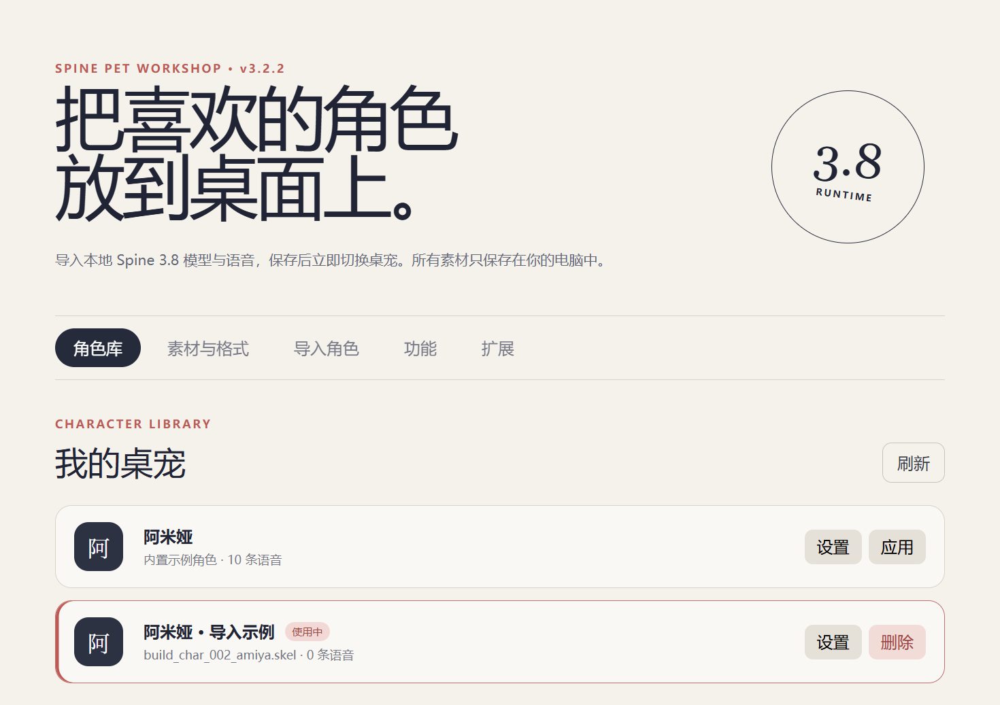

上图为新版真实界面。管理器顶部的五个栏目各有分工：

| 栏目 | 在这里做什么 |
| --- | --- |
| 角色库 | 查看已导入角色，点击“应用”切换，点击“设置”调整该角色的预览、大小、字幕与语音参数 |
| 素材与格式 | 查看模型要求、语音方案和素材来源入口 |
| 导入角色 | 选择模型和可选语音，预览后导入并切换 |
| 功能 | 启用/关闭内置及已安装功能，调整全局提醒与开机启动 |
| 扩展 | 导入插件 ZIP，查看版本与运行状态，调整插件设置，重启、禁用或卸载外部插件 |

角色卡片上的“使用中”表示当前桌宠。“删除”会删除程序内已导入的那份角色素材，不会删除原始下载文件；内置示例角色不能删除。

## 导入新角色

### 1. 准备一套完整模型

本工具使用 **Spine Runtime 3.8**。请准备与该版本兼容的骨骼文件、图集和所有贴图，把它们放在同一个角色文件夹内：

```text
我的角色/
├─ character.skel       骨骼与动画，也支持兼容的 .json
├─ character.atlas      图集描述
└─ character.png        贴图；可能有多张，也支持 JPG/WebP
```

不要只下载 `.skel`，也不要随意修改贴图文件名；`.atlas` 引用的名称和相对路径需要对应实际文件。支持包含子目录的模型文件夹。

如果使用明日方舟基建小人，可以从 [Ark-Models 的 models 目录](https://github.com/isHarryh/Ark-Models/tree/main/models)寻找素材；角色 ID 可以参考仓库的 `models_data.json`。先下载一套角色的骨骼、图集和贴图即可，不必下载整个模型库。[模型来源与格式说明](https://github.com/isHarryh/Ark-Models)

### 2. 选择模型并填写动作

1. 在管理器中打开“导入角色”，填写一个便于识别的角色名称。
2. 点击“选择模型文件夹”，选中刚才准备的**文件夹**，不是单独的骨骼文件。
3. 确认界面显示骨骼、图集和贴图数量。如果有多套模型，在“主骨骼文件”“图集文件”中选择配套文件。
4. 动作映射不确定时可以先留空，程序会尝试识别常见名称。如果模型有特殊命名，再填写实际动画名。

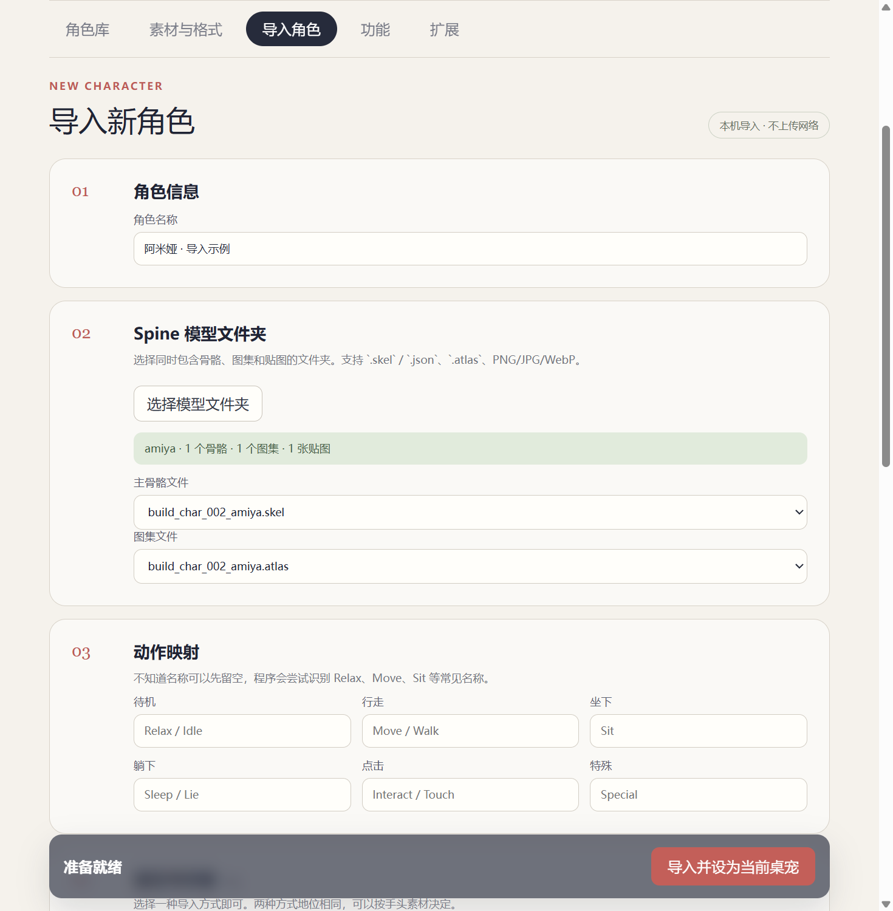

常见动作名示例：待机 `Relax / Idle`、行走 `Move / Walk`、坐下 `Sit`、躺下 `Sleep / Lie`、点击 `Interact / Touch`。它们只是示例，必须以模型真实动画名为准；没有某个动作的模型不会自动补出该动作。

### 3. 添加语音与字幕（可选）

**只想让角色显示和走动，可以直接跳过语音。** 需要语音时，下列两种方案任选其一：

- **方案 A · 单句音频**：点击“添加单句音频”，选择已经切好的 MP3、WAV 或 OGG，再为每条音频填写字幕。
- **方案 B · 明日方舟长音频**：点击“选择长音频”，选择角色整合音频，确认“角色 ID”和“音频语种”。程序使用内置时间轴分句，并匹配简中台词，不需要先用 FFmpeg 切片。

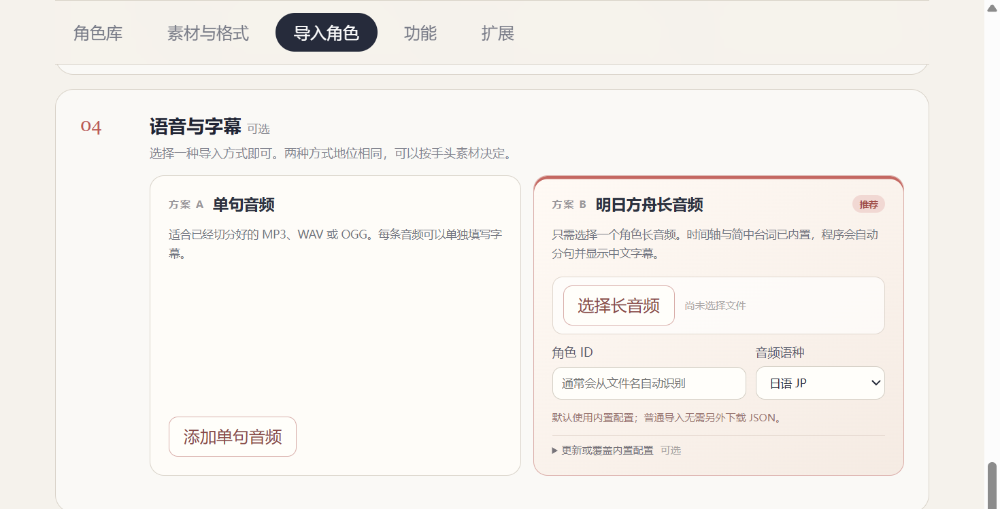

长音频可以从 [Ark-Voice](https://github.com/isHarryh/Ark-Voice)获取：`voice/` 为日语，`voice_cn/` 为普通话，`voice_en/` 为英语，`voice_kr/` 为韩语。下载的音频必须与所选角色和语种一致。

例如，阿米娅的角色 ID 是 `char_002_amiya`。文件名包含角色 ID 时会自动识别；改过文件名后请手动检查。普通导入无需另选 JSON；遇到内置数据尚未收录的新角色时，展开“更新或覆盖内置配置”，按需选择新版 `voice_data.json` 和／或 `charword_table.json`。详见 [语音与素材说明](docs/versions/v2.2.md#三准备语音)。

### 4. 预览、校准并完成导入

选择模型后，下方“角色预览与参数”会加载角色；可以切换动画检查效果，并调整大小、字号、气泡高度与背景透明度。

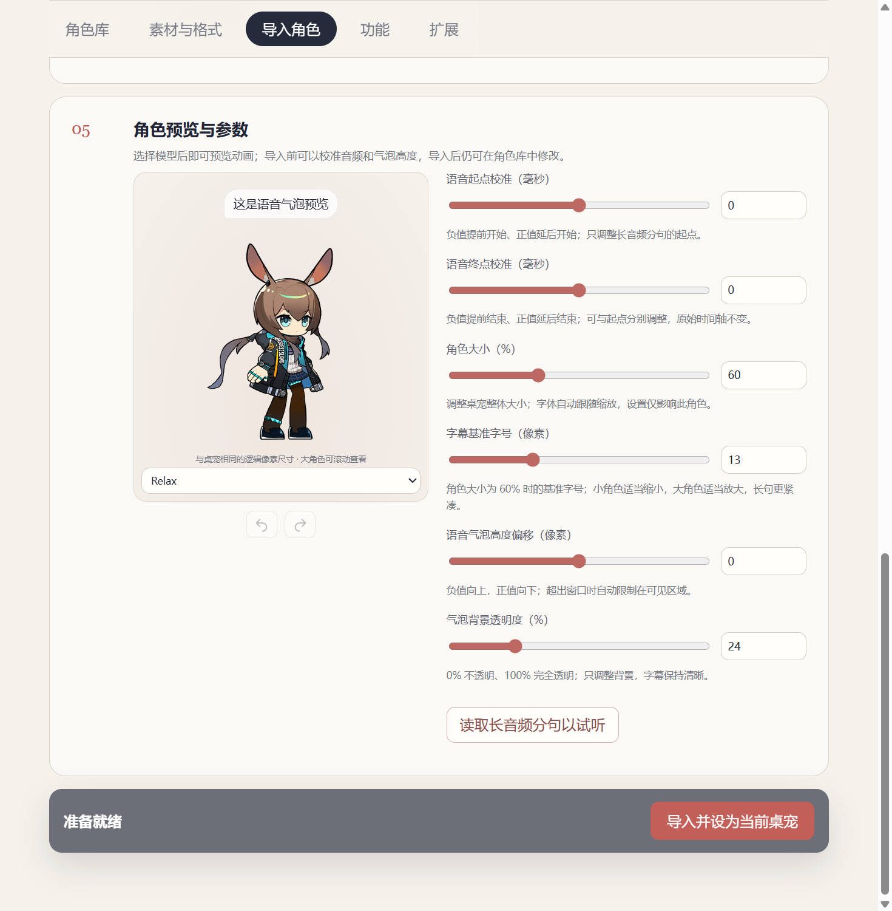

1. 如果使用长音频，点击“读取长音频分句以试听”，选择一句试听。
2. 语音开头被截断或尾部串入下一句时，分别调整“语音起点校准”和“语音终点校准”，再试听确认。
3. 气泡高度滑块向右提高气泡；数值框中负值向上、正值向下。透明度越高，气泡背景越透明。
4. 最后点击页面底部的**“导入并设为当前桌宠”**，等待提示导入完成。程序会复制素材到角色库，并自动切换桌宠。

预览下方的箭头可以撤销／重做参数修改：`Ctrl+Z` 撤销，`Ctrl+Shift+Z` 或 `Ctrl+Y` 重做。导入后的参数仍可修改，不需要重新导入。

## 调整已有角色

在“角色库”点击对应角色的“设置”，打开预览和参数面板：

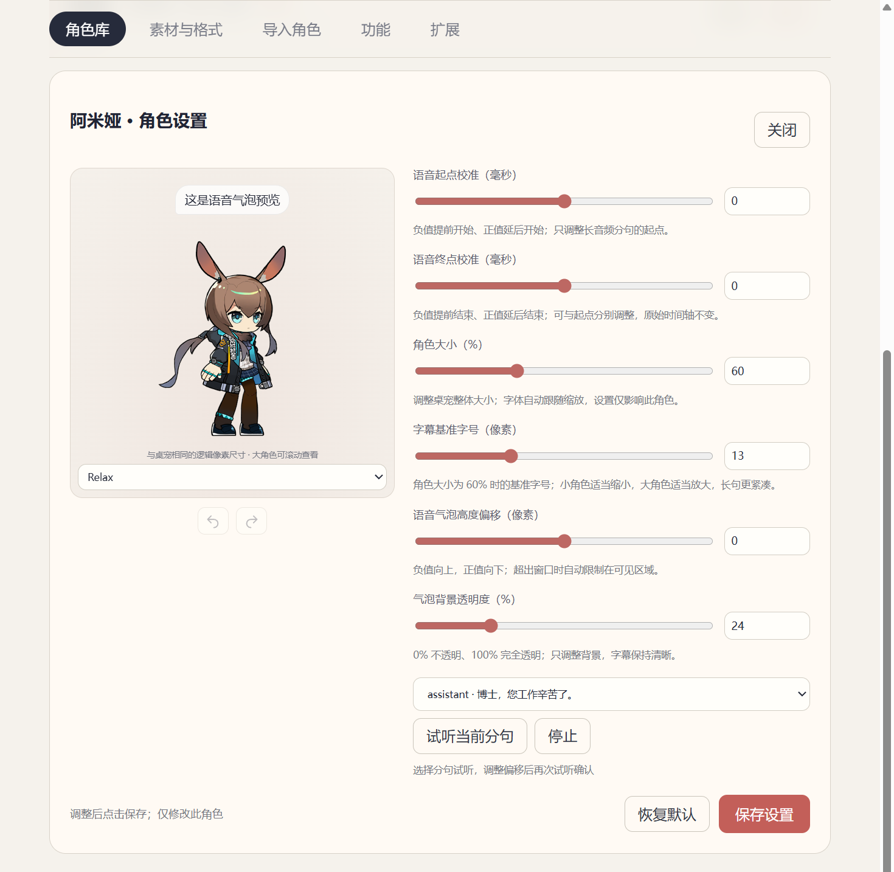

- 预览按桌宠实际比例显示，不会再次缩小；较大的角色可以滚动查看。
- 角色大小、字幕字号、气泡位置和语音起止校准都是**逐角色保存**，切换角色不会覆盖其他角色的参数。
- 修改后点击“保存设置”，当前角色立即应用；语音参数从下一次播放开始生效。
- “恢复默认”会重置当前编辑参数，确认后仍需点击保存。

> 注意：角色参数需要点击“保存设置”；下方“功能”页的开关则会自动保存。

## 桌面胶囊与功能开关

在管理器“功能”页启用需要的模块，关闭后不再采集对应信息，也不再显示对应入口。

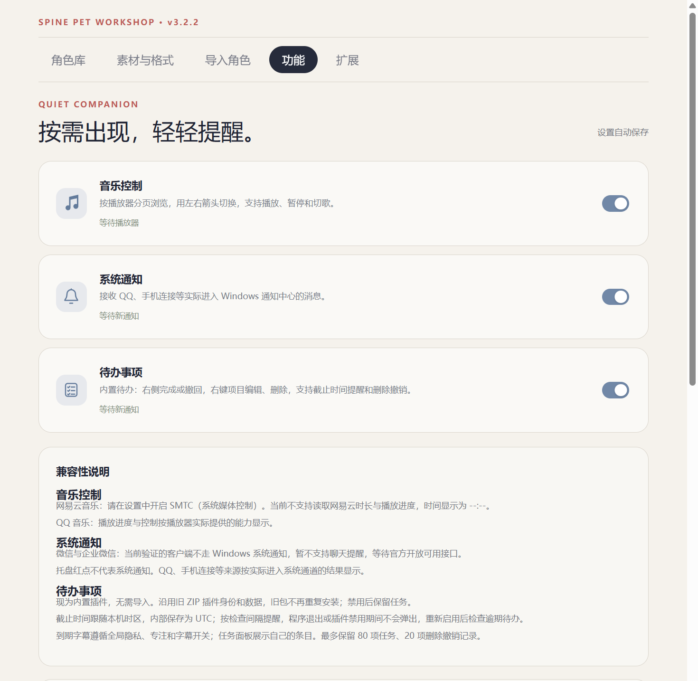

回到桌面，把鼠标放在角色上：

1. **浏览入口**：滚轮横向浏览胶囊中的功能图标，最右侧设置入口保持不动。
2. **预览与固定**：悬停图标打开预览，点击图标固定面板；再点当前图标或图钉可取消固定，`Esc` 或关闭按钮可收起。
3. **翻页**：音乐按播放器、通知按消息、Codex 按额度／最近任务分页。使用面板右下角左右箭头翻页，标题随当前页面切换。滚轮只滚动当前页内容，到边界也不翻页；也支持左右方向键和 `PageUp / PageDown`，输入框内编辑不触发翻页。
4. **调整大小**：鼠标移到内容面板的边缘或角上，拖动调整大小，尺寸自动保存。

没有可读取的播放器时，音乐入口不出现；Codex 未安装，或本机状态不可用时不出现 Codex 入口。**通知入口是例外**：只要该功能启用，铃铛就保留；新消息有红点，查看后仅消除红点，没有新消息时显示空状态。

## 待办事项

待办已内置，**不用下载插件**。打开清单图标，点击“新增待办”，填写标题即可；备注与截止时间可以留空。

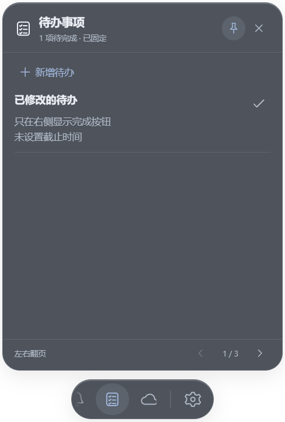

- **完成 / 撤回**：未完成项目右侧打勾；用右下角下一页打开“已完成”，点击撤回图标恢复。
- **编辑 / 删除**：右键事项打开菜单；删除后可点“撤销删除”恢复。键盘也可用 Shift+F10 打开菜单。
- **截止提醒**：选择截止时间后，桌宠运行且插件启用时会检查到期事项；提醒遵循全局隐私、专注与字幕开关。退出程序期间不会弹出。
- **数据保留**：禁用不会清空任务；旧 ZIP 版待办的数据和配置会沿用，现在不能用同 ID ZIP 覆盖内置项。

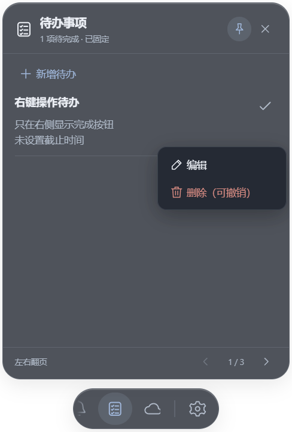

## 天气与 Codex 插件

### 安装或更新 ZIP

1. 从本版本 Release 下载对应插件 ZIP，**保留 ZIP，不要解压**。
2. 右键角色打开管理器，或点击胶囊最右侧齿轮，进入“扩展”。
3. 点击右上角“导入插件 ZIP”，选择文件，核对名称、版本与权限，然后确认。
4. 列表显示“运行中”后，回到桌面打开对应图标；暂时没有内容时检查页面提示。
5. 更新插件时重复导入新版 ZIP。**只更新 EXE 或源码，不会更新已经安装的旧插件包**。

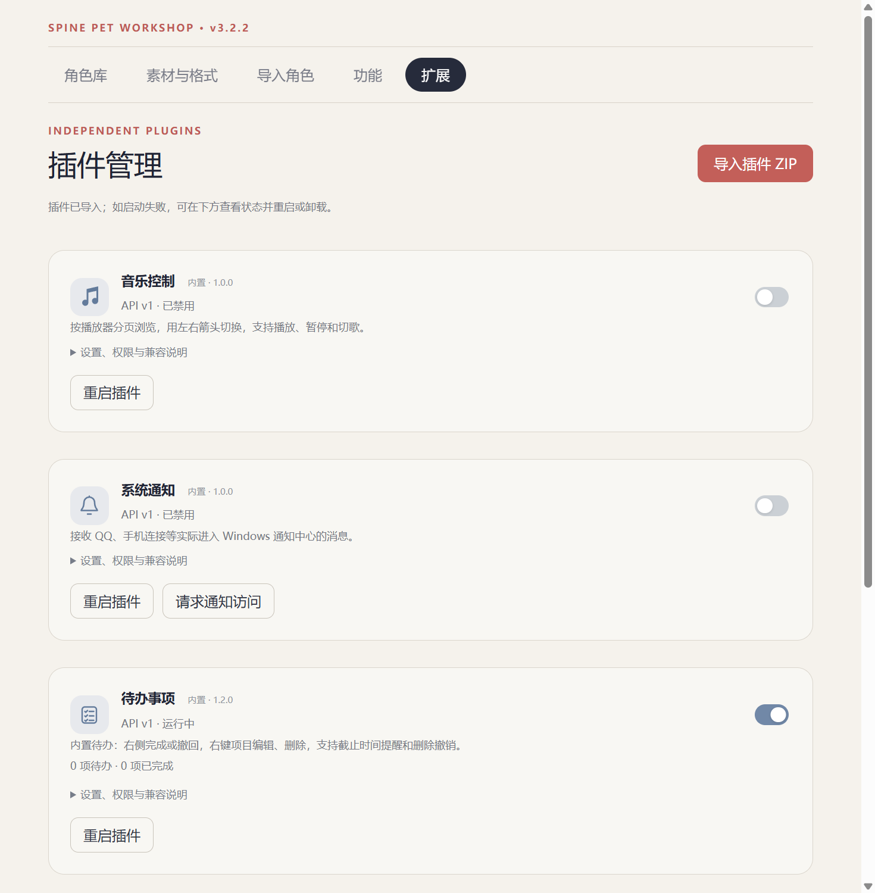

| 功能 | 是否随宿主安装 | 请求的权限 | 配置入口 |
| --- | --- | --- | --- |
| 待办事项 | 内置 | 本插件存储、角色提醒 | 扩展 → 待办 → 设置 |
| 天气与预报 | 下载天气 ZIP 后导入 | 本插件存储、受控天气查询 | 天气 → 城市设置；扩展 → 天气 → 设置 |
| Codex 信息 | 下载 Codex ZIP 后导入 | 本机 Codex 只读状态、角色提醒 | 保持本机 Codex 已登录且运行；扩展 → Codex |

外部插件可重启、禁用或卸载；卸载保留本机数据，相同 ID 重装可恢复。当前没有插件市场、自动更新或发布者签名，仅导入可信来源。

### 天气：先选城市，再看预报

1. 打开**云朵图标**，用右下角箭头进入“城市设置”。
2. 输入城市名（至少 2 个字符），点击“搜索城市”，核对省份/国家后点击“选择”。中文无结果时可尝试拼音或英文，例如 Hangzhou。
3. 也可在下方输入地点名称和 WGS84 纬度/经度，不需要设备定位权限。
4. 自动切到当前天气页；左右箭头查看未来 24 小时与 7 天预报，长列表用滚轮浏览。

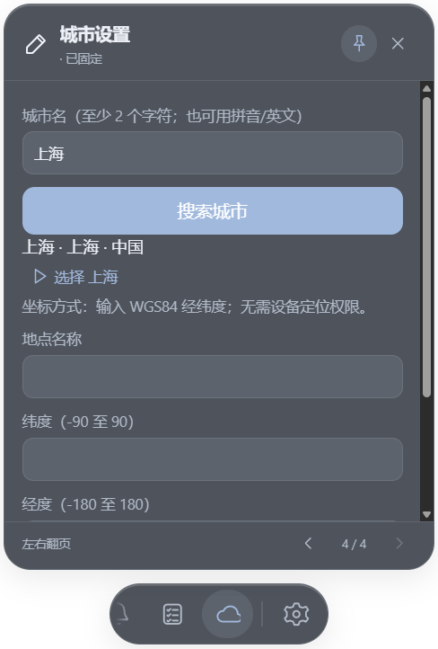

预报页副标题显示**所选城市**，不会把 Asia/Shanghai 等时区当作城市名称。预报时间按地点时区显示。“刷新天气”可手动更新；断网时保留缓存并标注失败或过期。

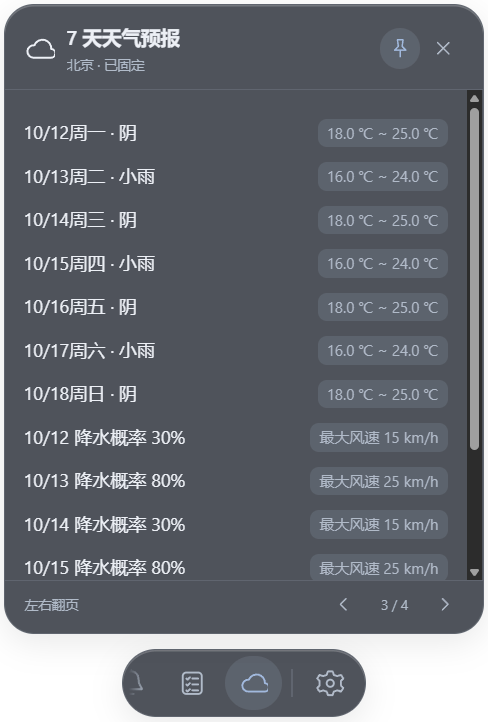

上方天气图为隔离测试的演示数据，用来说明操作，不代表当天实际天气。角色管理器“扩展 → 天气 → 设置、权限与兼容说明”可关闭自动刷新、调整刷新间隔（默认 30 分钟）和摄氏/华氏单位。

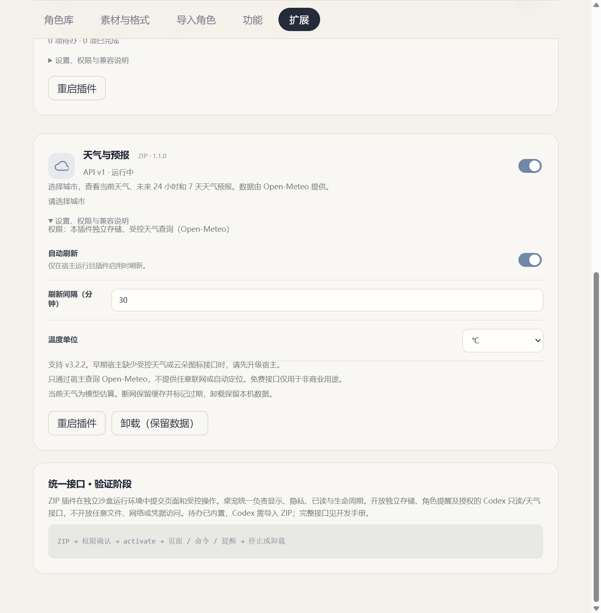

天气来自 [Open-Meteo](https://open-meteo.com/en/docs)，无需 API 密钥；城市搜索/查询会把输入的城市或坐标发送给该服务，服务可看到来源 IP。当前天气属于模型估算，预报会更新，不提供官方灾害预警。免费托管接口限于非商业用途，数据许可及限制见 [天气插件说明](examples/weather-plugin/README.md)。

### Codex：从旧版升级后也要导入

v3.1.2 的 Codex 已改为选装插件，升级后没有入口时，先导入上方 Codex ZIP，再保持本机 Codex 已登录、正在运行。额度或任务字段不可读取时显示“未知”，不会猜测。

它只读取额度和任务状态，可能显示任务名称；不调用模型、不创建或修改任务。禁用或卸载后停止订阅。详见 [Codex 插件说明](examples/codex-plugin/README.md)。

## 音乐控制与网易云设置

支持读取播放器上报的曲名、歌手、封面，以及播放／暂停、上一曲／下一曲；具体按钮和数据取决于播放器的系统媒体接口。不会监听桌宠自己的语音频道。

### QQ 音乐

1. 在桌宠“功能”页开启“音乐控制”。
2. 打开 QQ 音乐并播放一首歌。
3. 悬停角色 → 音乐图标，查看曲目信息并控制播放。若同时有多个播放器，可以用右下角箭头切换播放器页面。

### 网易云音乐：先开启 SMTC

**SMTC 是 Windows 系统媒体控制接口，不是 SMCT。** 网易云需要先开启这个选项，桌宠才能读取并控制播放器。

1. 打开网易云音乐 PC 客户端的“设置”（顶部设置图标）。
2. 进入**“常规”**页，向下找到“系统”区域。
3. 勾选**“开启 SMTC”**，其说明为开启后将播放信息同步到系统菜单栏及第三方软件。不同客户端版本的入口位置可能略有变化。
4. 播放一首歌，再到桌宠的音乐面板检查；若尚未出现，尝试重新播放或重启网易云客户端。


还可以先检查 Windows 是否识别到播放器：在 Windows 11 点击任务栏的音量／网络区域（或按 `Win+A`），查看快速设置上方有没有网易云的系统媒体卡片。看到曲目和播放按钮，说明播放器已向系统上报媒体信息；这张图是**Windows 的媒体卡片，不是桌宠面板**。


**当前限制**：网易云的时长与播放进度暂不支持读取，显示 `--:--`，并非控制功能故障；封面也以播放器实际提供的数据为准。对应兼容说明同时保留在角色管理器“功能”页。

## 系统通知与隐私

1. 在“功能”页开启“系统通知”。
2. 点击“请求通知访问”，按系统提示允许访问；同时确认来源应用能够向 Windows 通知中心发送通知。
3. 让 QQ、手机连接等应用收到一条新通知，检查角色字幕和铃铛红点。
4. 收到通知后，来源应用会出现在“应用通知”列表中，可单独关闭不想接收的来源。

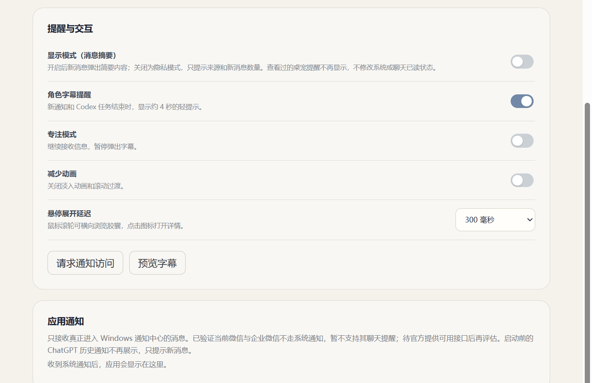

- **显示模式（消息摘要）开启**：新消息弹出简要标题与正文，两行摘要放不下时省略。
- **显示模式关闭，即隐私模式**：只提示来源和新消息，不显示消息正文。
- **角色字幕提醒**：控制是否在角色旁弹出轻提示；“预览字幕”可用于检查效果。
- **专注模式**：继续接收信息，但不主动弹出字幕；“减少动画”可减少界面过渡。

查看过的桌宠提醒不会重复展示，特别是启动前的 ChatGPT 历史通知不会重新提示。查看只影响桌宠自己的提醒，**不会删除系统通知，也不会把 QQ 等聊天标记为已读**。

> v3.1.2 已验证当前微信和企业微信客户端不走 Windows 系统通知，因此暂不支持它们的聊天提醒。托盘有红点、应用内有未读，并不代表通知进入了 Windows 通知中心；等待官方开放可用接口后再评估。

## Codex 信息与开机启动

**Codex 信息**：先在“扩展”导入 Codex ZIP，再在“功能”页开启，并保持本机 Codex 已登录、正在运行。可读取时显示剩余额度、重置时间及最近任务状态，约每 15 秒刷新；额度和最近任务可以用左右箭头翻页。数据未提供时显示未知，不猜测额度。此模块只读本机服务，**不调用模型、不启动任务，也不是 AI 对话入口**。

**开机启动**：在“功能 → 应用启动”手动开启，默认关闭。登录 Windows 后启动桌宠，不自动弹出管理器；仅支持安装版或便携版，不会把开发用 Electron 注册进启动项。移动、改名或换用新版便携文件后，请在新版中重新登记；如果开关仍为开启，先关闭再开启。

## 常见问题

| 问题 | 先检查什么 |
| --- | --- |
| 找不到模型，或提示缺少图集／贴图 | 选择的是完整文件夹；里面有骨骼、`.atlas` 和全部贴图，贴图名与图集引用一致 |
| 模型无法加载，或动画不正常 | 模型是否兼容 Spine 3.8；在预览中确认真实动画名，再填写动作映射 |
| 长音频无法分句，或没有字幕 | 角色 ID、音频语种和文件是否对应；新角色可能需要更新内置配置 |
| 语音开头被截断，或尾部串句 | 到角色“设置”分别校准语音起点和终点，试听后保存 |
| 音乐入口没有出现 | 桌宠音乐功能已开启，播放器正在播放并向系统上报；网易云先开启 SMTC |
| 网易云时间显示 `--:--` | 当前兼容限制，暂不支持时长和进度；不影响可用的播放控制 |
| 应用有未读，但桌宠没有通知 | 必须是真正进入 Windows 通知中心的通知；检查通知访问权限，微信／企业微信暂不支持 |
| 没有 Codex 入口，或额度未知 | 先导入 Codex ZIP，再检查插件启用、本机已登录并运行；未知额度不会推测 |
| 更新后天气仍是时钟图标或时区副标题 | 扩展中核对天气版本，重新导入本 Release 的 v1.1.0 ZIP；只升级宿主不会替换旧包 |
| 搜索城市无结果／天气加载失败 | 尝试拼音/英文或经纬度；检查网络，失败时缓存仍保留 |
| 为什么滚轮不能翻页 | v3.2.2 改为右下角左右箭头；滚轮只浏览当前页内容 |
| 找不到待办的编辑／删除 | 右键事项，或聚焦事项后按 Shift+F10 |
| 参数调整后重新打开又变回去 | 角色参数需要“保存设置”；功能开关才是自动保存 |
| 便携版升级后仍启动旧版 | 从新版设置重新登记开机启动，更新启动文件路径 |

用户角色库默认位于 `%APPDATA%\spine-pet-workshop\characters\`。备份时先退出程序，再备份 `%APPDATA%\spine-pet-workshop\`；不要在运行时手工修改角色配置。

更详细的说明见 [v3.2 使用说明](docs/versions/v3.2.md)、[模型与语音格式说明](docs/versions/v2.2.md)及 [角色参数说明](docs/CHARACTER_PARAMETERS.md)。固定阿米娅版见 [v2.1 使用说明](docs/versions/v2.1.md)。

## 版本

| 版本 | 状态 | 内容 |
| --- | --- | --- |
| v1 | 本地测试，不公开发布 | 角色和基础动作 |
| v2.1.1 | 正式版 | 包装好的阿米娅桌宠，动作、语音、字幕和置顶修复 |
| v2.2.4 | 历史正式版 | 导入 Spine 角色、自定义语音、长音频分句和角色管理 |
| v2.3.1 | 本地开发，未发行 | 音频手动校准、气泡高度、左右随机行走、角色预览与逐角色参数 |
| v3.1.1 | 本地开发预览 | 滚轮胶囊、音乐控制、系统通知、Codex 信息与功能开关；未公开发布 |
| v3.1.2 | 历史正式版 | 平滑吸附分页、预览撤销重做、开机启动修复、通知常驻入口与兼容说明 |
| v3.2.2 | 历史正式版 | 内置待办、ZIP 插件、天气与 Codex 选装、左右分页和待办右键菜单 |
| v3.2.3 | 当前正式版 | GitHub 社区插件目录、开发入口、计数器示例、投稿与目录校验 |
| v4 | 规划中 | 评估 AI 对话和行为能力 |

详见 [更新日志](CHANGELOG.md)、[版本前瞻](ROADMAP.md)。

## 社区插件与开发入口

[浏览社区插件](community/README.md) · [插件安装使用手册](docs/PLUGIN_USAGE.md) · [手写第一个插件](docs/PLUGIN_QUICKSTART.md) · [完整开发规范](docs/PLUGIN_DEVELOPMENT.md) · [提交插件 PR](community/CONTRIBUTING.md)

v3.2.3 新增 GitHub 社区目录、投稿模板和目录校验，无需独立网站。下载 [计数器入门 ZIP](https://github.com/xjunrao-ux/spine-pet-workshop/releases/download/v3.2.3/Hello-Counter-v1.0.0.zip) 即可体验零权限示例。作者在自己的仓库发布插件，通过 PR 向本仓库提交收录信息；审核后进入目录，用户下载 ZIP 手动导入。当前未提供应用内商店、在线安装或自动更新。

## 开发

以下内容仅供开发者，直接使用 Release 的用户不需要执行。技术栈：Electron、TypeScript、Vite、PixiJS、Spine 3.8、PowerShell / Win32。

### 插件二次开发（v3.2.3 / API v1）

独立插件可打包成 ZIP，在角色管理器的“扩展”页导入，无需修改主程序。请阅读 [插件开发规范与接入手册](docs/PLUGIN_DEVELOPMENT.md)：提供可运行示例、接口、组件、权限、存储、提醒、调试与发布规范。正式版内置音乐、通知和待办；待办右侧完成/撤回，右键编辑/删除，并兼容旧 ZIP 数据。Codex 改为外置，可用 `pnpm package:codex` 生成 ZIP 后导入；宿主提供受控只读订阅，并提供受控天气查询。可用 pnpm package:weather 生成天气 ZIP。v3.1.2 正式版不支持 ZIP 导入，插件市场与自动更新尚未实现。

### 宿主开发

```powershell
pnpm install --frozen-lockfile
pnpm dev
```

构建与打包：

```powershell
pnpm build
pnpm package:win
```

首次使用 pnpm 时可按 `package.json` 安装 pnpm 11.19.0。构建产物自动写入 `release/v<版本号>/`，当前为 `release/v3.2.3/`，不提交到 Git。第三方角色模型和音频不在公共源码中；从源码运行时请准备本地素材，或通过角色管理器导入自己的角色，详见 [素材说明](public/README.md)。

```text
electron/   主进程、系统窗口、IPC 和语音配置解析
src/        动画、交互、字幕及角色管理界面
public/     运行资源和来源说明
assets/     软件图标
docs/       使用、开发与版本发布说明
scripts/    测试、截图及发布工具
.github/    GitHub 构建验证
```

日常开发保留在本地 `dev/v3`，正式快照整理到 `main`。维护者请看 [本地开发与 Git 使用](docs/DEVELOPMENT.md)、[正式发布流程](docs/RELEASING.md)及 [扩展模块接口](docs/EXTENSIONS.md)。

v2.3.1 本地开发说明见 [使用说明](docs/versions/v2.3.1.md) 和 [角色参数扩展接口](docs/CHARACTER_PARAMETERS.md)。稳定线修复通过 `scripts/Sync-StableToV3.ps1` 单向同步到本地 v3，开发分支不推送。

## 素材与许可

本项目不是《明日方舟》官方项目。角色、模型、动画、语音、台词和美术内容的权利归各自权利人所有。素材来源保留在对应的 `SOURCE.md` 中，使用和分发素材需遵守其来源条款。

代码目前没有授予开源复用许可，`package.json` 标记为 `UNLICENSED`。Spine Runtime 有独立许可；代码与第三方素材的许可范围应分别处理。
