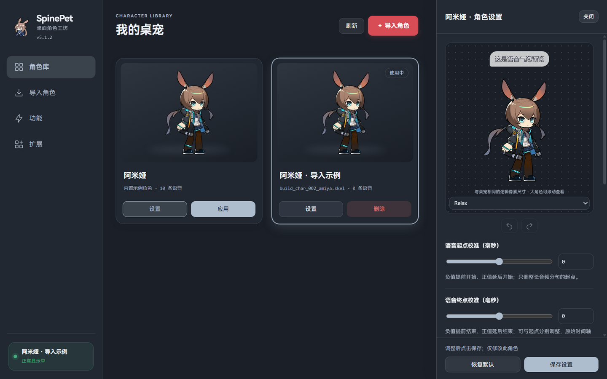
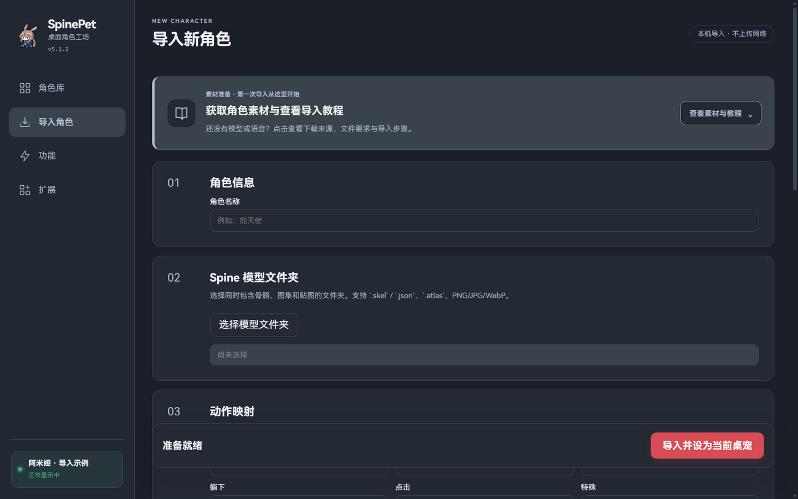
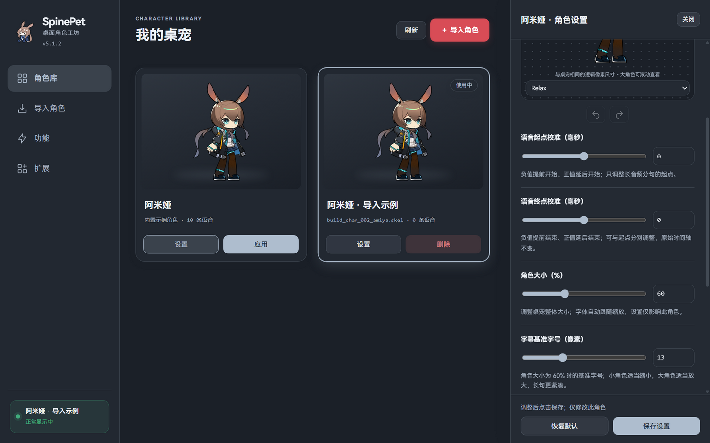
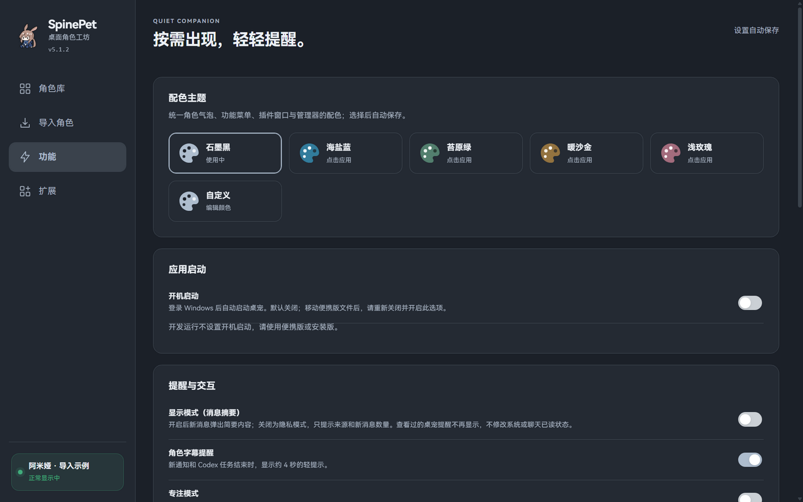
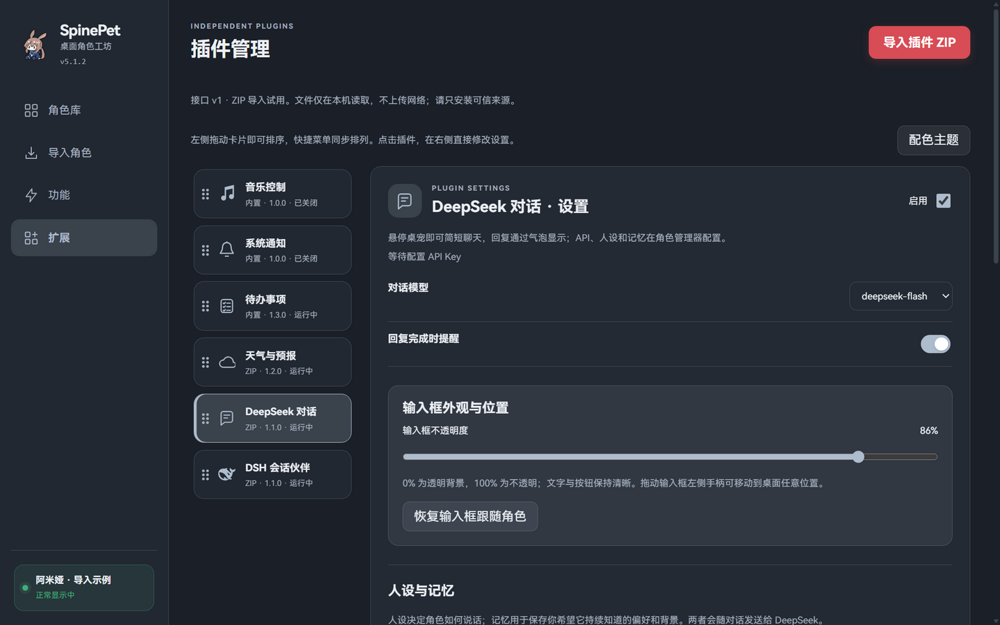

# SpinePet

把喜欢的角色放到 Windows 桌面上。导入本地 Spine 3.8 模型与语音，让角色陪伴工作、走动、坐在窗口边缘，也可以使用音乐控制、系统通知、待办和选装插件。

**正式版 v5.2.2 · Windows x64 · 2026-10-25**

[下载正式版](https://github.com/xjunrao-ux/spine-pet-workshop/releases/tag/v5.2.2) · [完整使用说明](docs/versions/v5.2.2.md) · [插件目录](community/README.md) · [插件开发](docs/PLUGIN_QUICKSTART.md) · [文档索引](docs/README.md)



v5.2.2 修复管理器任务栏和窗口标题栏显示 Electron 默认图标的问题，Windows 窗口改用多尺寸 ICO，并显式指定任务栏图标。

## 下载与运行

普通用户下载 EXE 即可，无需安装 Node.js、pnpm 或 Electron。

| 文件 | 用途 |
| --- | --- |
| [SpinePet-Setup-v5.2.2-x64.exe](https://github.com/xjunrao-ux/spine-pet-workshop/releases/download/v5.2.2/SpinePet-Setup-v5.2.2-x64.exe) | 安装版，支持选择安装目录和创建快捷方式 |
| [SpinePet-Portable-v5.2.2-x64.exe](https://github.com/xjunrao-ux/spine-pet-workshop/releases/download/v5.2.2/SpinePet-Portable-v5.2.2-x64.exe) | 免安装运行；用户数据仍保存在 Windows 用户目录 |
| [SHA256SUMS.txt](https://github.com/xjunrao-ux/spine-pet-workshop/releases/download/v5.2.2/SHA256SUMS.txt) | 核对 EXE、插件和其他附件的完整性 |
| [USAGE-v5.2.2.md](https://github.com/xjunrao-ux/spine-pet-workshop/releases/download/v5.2.2/USAGE-v5.2.2.md) | 离线使用说明 |

GitHub 自动生成的 Source code.zip 是源码，不是可运行安装包。升级前先退出旧版，再安装或运行新版；正常升级保留角色、待办、插件配置和个人设置。更换便携版位置后，请在“功能 → 应用启动”重新登记开机启动。

## 第一次使用

1. 首次启动会显示内置阿米娅与角色管理器，可以先体验，无需准备模型。
2. 左键拖动角色，短按互动，右键选择动作或打开“角色管理器”。系统托盘右键也能打开管理器、显示/隐藏或退出。
3. 左侧“角色库”切换角色；“设置”打开右侧预览与参数栏，修改后点击“保存设置”。
4. 需要新角色时，进入“导入角色”，点击顶部醒目的“获取角色素材与查看导入教程”。
5. “功能”调整主题、开机启动、提醒与交互；“扩展”导入可选插件 ZIP、修改配置并拖动排序。

关闭管理器只关闭管理窗口。退出整个软件请使用桌宠或系统托盘的右键菜单。

“更新与开发”页支持安装版检查 GitHub 正式版、后台下载及重启覆盖升级；便携版到发布页下载。已收录的已安装插件可独立检查并确认更新。页面提供 Release 插件下载与 ZIP 导入说明，以及 GitHub 仓库和开发手册入口。功能页新增“默认开启角色语音”，立即应用并记住下次启动选择。详见[正式发布流程](docs/RELEASING.md)。

## 导入角色与语音



模型需要兼容 **Spine Runtime 3.8**：同一文件夹内准备 `.skel / .json`、`.atlas` 和它引用的所有 PNG/JPG/WebP 贴图。选择文件夹后确认主骨骼与图集；动作名称不确定时可以先留空，程序会识别常见名称。

- 模型来源：[Ark-Models](https://github.com/isHarryh/Ark-Models)。下载完整的一套骨骼、图集与贴图，保留相对路径。
- 可选语音：[Ark-Voice](https://github.com/isHarryh/Ark-Voice)。支持单句音频并手填字幕，或导入明日方舟整合长音频，由内置时间轴和简中台词自动分句。
- 确认角色 ID 与语种，预览并试听；最后点击红色“导入并设为当前桌宠”。原始下载文件不会被移动或删除。

角色库的左下角状态框显示当前角色名。绿色表示模型已加载且正在显示；红色表示隐藏、加载中或异常，文字说明原因，鼠标悬停可查看完整信息。



六个参数分别控制语音起点、语音终点、角色大小、字幕字号、气泡高度和背景透明度。每个角色独立保存，支持撤销/重做。气泡高度滑块向右提高；语音偏移以毫秒计，正值延后、负值提前。

## 主题与日常功能



- **配色**：石墨黑、海盐蓝、苔原绿、暖沙金、浅玫瑰及自定义。可自定义主色、页面/面板背景和两级文字颜色，自动保存并同步到桌宠与插件窗口。导入按钮始终使用红色。
- **待办**：内置；支持新增、编辑、完成/撤回、删除撤销、截止提醒和分类页。
- **音乐**：读取 Windows 系统媒体接口，提供播放器支持的播放/暂停与切歌。网易云音乐需要先开启 SMTC；部分播放器不提供进度、时长或封面。
- **通知**：只接收进入 Windows 通知中心的消息，支持隐私模式、来源过滤、字幕和专注模式。当前微信/企业微信聊天不走这一接口，不能作为其聊天提醒工具。
- **窗口**：悬停角色查看功能胶囊，点击固定面板；面板可以翻页、拖动与调整尺寸。聊天输入框可独立拖动，在插件设置恢复跟随。

## 选装插件



在 Release 下载 ZIP 后，进入“扩展 → 导入插件 ZIP”，核对名称和权限后安装，**不要解压 ZIP**。更新 EXE 不会自动更新已有插件；重新导入相同 ID 的新 ZIP 会保留配置和持久化数据。

| 插件 | 版本 | 下载及说明 |
| --- | --- | --- |
| 天气与预报 | 1.2.0 | [ZIP](https://github.com/xjunrao-ux/spine-pet-workshop/releases/download/v5.2.2/Weather-Plugin-v1.2.0.zip) · [说明](examples/weather-plugin/README.md)，在管理器设置城市 |
| Codex 信息 | 1.1.0 | [ZIP](https://github.com/xjunrao-ux/spine-pet-workshop/releases/download/v5.2.2/Codex-Plugin-v1.1.0.zip) · [说明](examples/codex-plugin/README.md)，只读本机额度与任务状态 |
| DeepSeek 对话 | 1.1.1 | [ZIP](https://github.com/xjunrao-ux/spine-pet-workshop/releases/download/v5.2.2/DeepSeek-Plugin-v1.1.1.zip) · [说明](examples/deepseek-plugin/README.md)，配置自己的 API Key 后使用气泡聊天，可切换点击角色触发并拖动输入框两侧调宽 |
| DSH 会话伙伴 | 1.1.0 | [ZIP](https://github.com/xjunrao-ux/spine-pet-workshop/releases/download/v5.2.2/DSH-Pet-Plugin-v1.1.0.zip) · [说明](examples/dsh-pet-plugin/README.md)，连接已授权的本机 DSH 桥服务 |
| 计数器示例 | 1.0.0 | [ZIP](https://github.com/xjunrao-ux/spine-pet-workshop/releases/download/v5.2.2/Hello-Counter-v1.0.0.zip) · [开发教程](docs/PLUGIN_QUICKSTART.md)，零权限入门示例 |

DeepSeek 对话使用你的服务商账户，发送相关对话、人设与手工记忆，费用由账户承担；不读取本机项目文件。DSH 插件需要另行配置兼容桥服务，不会自动接管本机项目。两种插件分别使用自己的连接设置。

## 数据、升级与卸载

用户数据位于 `%APPDATA%\spine-pet-workshop\`；SpinePet 改名与版本更新继续沿用该目录。备份前先退出程序。角色原件、API 密钥和个人会话不属于 GitHub 源码或 Release 测试资料。

禁用插件保留数据；卸载外部插件保留独立数据和包缓存，同 ID 重装可恢复。卸载应用也保留用户资料；需要完全清除时，在退出后先备份再手动处理用户目录。

## 从源码开发

需要 Windows x64、Node.js 24 与 pnpm 11。第三方模型和音频不提交到公共仓库，按 [素材目录说明](public/README.md) 放入本地 `public/models/amiya/` 和可选语音目录。

```powershell
pnpm install --frozen-lockfile
pnpm build
pnpm start
```

构建后可双击 `启动桌宠.cmd`。开发热更新使用 `pnpm dev`；打包使用 `pnpm package:win`。详见 [开发与测试](docs/DEVELOPMENT.md)、[发布流程](docs/RELEASING.md)和[验证记录](docs/VALIDATION_v5.2.2.md)。

## 许可与来源

宿主代码目前为 `UNLICENSED`；公开可查看源码不代表授予开源复用许可。计数器示例与 DSH 桥目录的许可仅适用于各自范围。角色、贴图、语音和第三方运行时遵循各自权利及许可；只导入有权使用的素材，禁止将游戏资源用于未经授权的商业用途。

[更新日志](CHANGELOG.md) · [已知限制与后续维护](ROADMAP.md) · [参与项目](CONTRIBUTING.md) · [历史版本](https://github.com/xjunrao-ux/spine-pet-workshop/releases)
