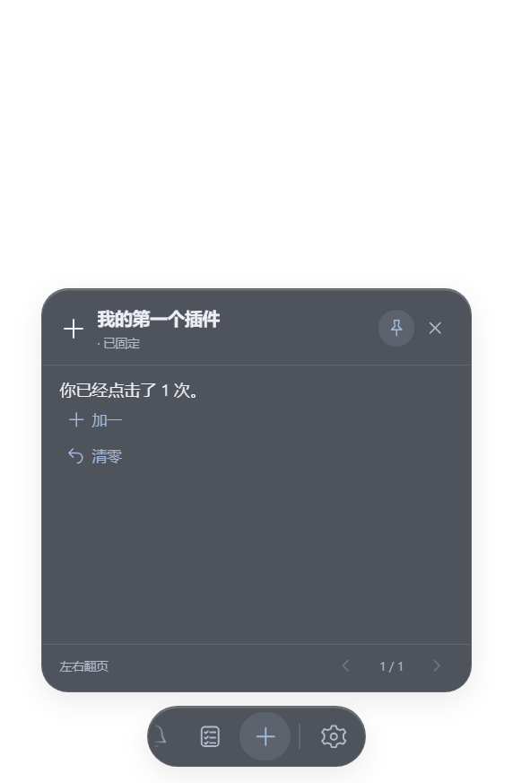

# 手写第一个插件：JavaScript 计数器

适用宿主 v3.2.3，也兼容 v3.2.2 的 API v1。本教程只需编辑文本文件；简单插件不用框架、依赖或编译。TypeScript 和多文件源码也可以开发，但交付前必须打包成单个 Worker 可运行的 JavaScript ESM 模块。当前不直接执行 Python、C#、Node.js 模块或 shell。

[下载计数器 ZIP](https://github.com/xjunrao-ux/spine-pet-workshop/releases/download/v3.2.3/Hello-Counter-v1.0.0.zip) · [完整示例源码](../examples/hello-counter-plugin/provider.js) · [清单](../examples/hello-counter-plugin/plugin.json) · [安装手册](PLUGIN_USAGE.md) · [完整 API 规范](PLUGIN_DEVELOPMENT.md) · [社区投稿](../community/CONTRIBUTING.md)

## 1. 先安装，再修改

下载 ZIP，在“角色管理器 → 扩展 → 导入插件 ZIP”安装，打开加号图标的计数器，尝试“加一”和“清零”。示例无权限、不联网、不保存数据；重启插件或程序后归零。



源码目录只有三份主要文件：`plugin.json` 声明身份、命令、权限和入口；`provider.js` 实现状态与页面；`README.md` 解释用法。示例新增源码的复制与修改范围见同目录 [LICENSE](../examples/hello-counter-plugin/LICENSE)；宿主及其他插件许可分别适用。

## 2. 理解运行关系

```text
activate(context) 创建 count
        ↓
getSnapshot() 返回文本和按钮 → 宿主统一绘制页面
        ↑                              ↓
        └──── execute('increment') ← 用户点击加一
```

`getSnapshot` 只读取当前状态，不在里面修改数据。按钮的 `commandId` 必须先在清单 `commands` 中声明；宿主检查参数和权限后调用 `execute`。命令完成后宿主再次读取快照。定时器等后台变化则需要作者主动调用 `context.publish(snapshot)`。

实例还必须提供 `dispose`，停止时释放定时器和订阅；禁用后宿主会销毁执行环境。不要依赖退出回调保存关键数据。

## 3. 自己手搓一次“减一”

先复制整个示例目录为自己的目录。在清单中改成你自己的稳定唯一 ID 和名称，避免与原示例相互替换。新增命令：

```json
{"id": "decrement", "permissions": [], "fields": {}}
```

在 `getSnapshot` 的 `blocks` 数组增加按钮：

```js
{ type: 'button', commandId: 'decrement', label: '减一',
  icon: 'undo', enabled: true, variant: 'text', payload: {} }
```

在 `execute` 的命令判断中加入：

```js
else if (commandId === 'decrement') {
  count = Math.max(0, count - 1);
}
```

文字、页面和按钮都由宿主统一渲染；不需要写 HTML/CSS。`metric` 组件目前表示 0–100 的百分比，不适合作为任意整数计数器，所以示例使用普通文本。

## 4. 打包和更新

打包需要 Node.js；以下命令在克隆后的宿主仓库根目录运行，不需要安装 Electron 才能打包这个无依赖示例：

```powershell
node scripts/package-plugin.mjs examples/hello-counter-plugin release/plugins/Hello-Counter-v1.0.0.zip
```

自己的插件请替换源码目录、输出文件名和清单版本。脚本只读取清单、入口和可选 README，执行非运行式 ZIP 校验，不执行插件代码。不要手工把外层文件夹压进去；`plugin.json` 必须位于 ZIP 根目录。宿主不会安装 npm 依赖或读取 ZIP 中第二个 JS 模块。

重新导入相同 ID 的新 ZIP 后测试按钮。更换 ID 会创建另一个插件；同 ID 会替换并启用已有插件。宿主目前不排序版本，也不自动阻止降级。

## 5. 想保存计数或提醒

- 持久化：声明 `storage.own`，激活时读取 `context.storage.get`；命令中串行处理写入，先 `await context.storage.set` 成功再更新内存和页面。
- 字幕：声明 `ui.reminders`，调用 `context.emit`。宿主管理隐私、静默和去重；可见字幕不是绝对可靠的业务投递确认。
- 天气与 Codex：分别通过 `weather.read` 与 `codex.read` 调用宿主受控接口。
- DeepSeek 官方对话：v4.1.1+ 的 `ai.deepseek`；其他本地服务：v4.2.2+ 的 `net.local`，见 [HTTP/SSE 接口](LOCAL_SERVICE_API.md)，需用户另行授权地址和令牌。
- 其他远程联网、系统文件、进程、DOM 或自定义窗口：当前未开放，先向维护者讨论新能力，不绕过沙盒。

需要完整表单、持久化和提醒的示例时，使用[开发手册中的便签](PLUGIN_DEVELOPMENT.md#2-从零做一个可安装插件)。

## 6. 提交到社区

先测试安装、主要操作、禁用、重启与卸载，再将源码与插件 ZIP 发布到你的 GitHub。按[投稿规范](../community/CONTRIBUTING.md)提交一个目录条目的 PR；无需网站，也不需要修改宿主注册表。示例 `com.example.hello-counter` 只用于学习，发布自己的插件必须改 ID。
